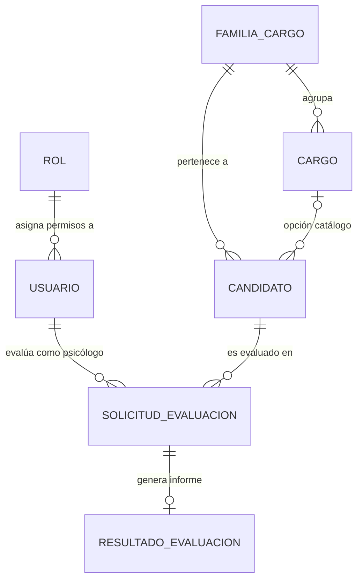

# Guía de Población y Manejo de Tablas de Base de Datos
## Sistema de Reclutamiento, Postulación y Evaluación Psicolaboral — AquaChile

Este documento describe la arquitectura relacional, el flujo de integridad de datos y las instrucciones paso a paso para poblar y administrar la base de datos de **Supabase (PostgreSQL)** en sincronía con la aplicación web.

---

## 1. Modelo de Datos y Flujo de Trabajo

El sistema conecta dos ámbitos:
1. **Público (Portal de Postulación):** Los postulantes registran su RUT, contacto y cargo deseado (predefinido del catálogo o libre).
2. **Privado (Dashboard Interno):** Supervisores, Analistas y Psicólogos gestionan a los candidatos, generan solicitudes de evaluación y emiten dictámenes clínicos.

### Diagrama de Relaciones (ERD)

---

## 2. Descripción de Tablas y Restricciones de Integridad

### 2.1 `public.rol`
Define los niveles de acceso del personal institucional.
* **`id`**: Clave primaria autonumérica.
* **`nombre`**: Identificador único (`analista`, `evaluador`, `admin`, `jefatura`).
* **`descripcion`**: Alcance de responsabilidades del rol.

### 2.2 `public.usuario`
Almacena exclusivamente las cuentas del personal con acceso al dashboard (psicólogos evaluadores, jefaturas, analistas y administradores).
* **`rol_id`**: Clave foránea que referencia a `public.rol(id)` (`ON DELETE RESTRICT`).

### 2.3 Catálogo Maestro: `public.familia_cargo` y `public.cargo`
* **`public.familia_cargo`**: Agrupaciones funcionales (`Operaciones / Producción`, `Tecnología / IT`, `Ventas / Comercial`, etc.).
* **`public.cargo`**: Catálogo de cargos estándar de AquaChile vinculados a su respectiva familia (`familia_id`). Permite activar o desactivar cargos (`activo boolean`).

### 2.4 `public.candidato` y la Restricción Híbrida (`check_candidato_cargo`)
Almacena a los postulantes. Puede postular a un cargo oficial del catálogo o escribir uno no listado (cargo libre / personalizado).
* **`familia_id`**: Obligatorio. Siempre debe tener una familia asignada.
* **`cargo_id`**: ID del catálogo si seleccionó una opción predefinida (o `NULL`).
* **`cargo_personalizado`**: Cadena de texto si escribió su propio cargo (o `NULL`).

> [!IMPORTANT]
> **Restricción `check_candidato_cargo`:**
> `(cargo_id IS NOT NULL AND cargo_personalizado IS NULL) OR (cargo_id IS NULL AND cargo_personalizado IS NOT NULL)`
> 
> Esta regla garantiza a nivel de base de datos que **nunca** existan simultáneamente ambos campos llenos ni ambos vacíos.

### 2.5 `public.solicitud_evaluacion` y `public.resultado_evaluacion`
* **`solicitud_evaluacion`**: Asigna un candidato (`candidato_id`) a un psicólogo (`evaluador_id -> usuario.id`).
* **`resultado_evaluacion`**: Contiene la entrevista clínica, notas y dictamen final (`Recomendado`, `Con observaciones`, `No recomendado`). Relación 1 a 1 con la solicitud.

---

## 3. Cuentas de Acceso al Dashboard (Autenticación por Correo Registrado)

El sistema valida el ingreso **únicamente comprobando la existencia del correo electrónico** en la tabla `public.usuario` de Supabase. Al coincidir el correo, se cargan automáticamente los permisos correspondientes a su `rol_id`:

| Nombre Completo | Correo Institucional Registrado | Rol Asignado | Funcionalidad en la App |
| :--- | :--- | :--- | :--- |
| **Ps. Camila Rojas** | `analista@aquachile.cl` | `analista` | Registro de candidatos, creación y seguimiento de solicitudes. |
| **Ps. Andrés Miranda** | `evaluador@aquachile.cl` | `evaluador` | Bandeja de entrevistas asignadas, registro de notas clínicas y dictámenes. |
| **Ps. Valentina Soto** | `valentina.soto@aquachile.cl` | `evaluador` | Evaluadora clínica asignable en solicitudes. |
| **Ps. Ignacio Fuentes** | `ignacio.fuentes@aquachile.cl` | `evaluador` | Evaluador clínico asignable en solicitudes. |
| **Administrador Duoc UC** | `admin@aquachile.cl` | `admin` | Acceso integral, mantenedor de catálogo de cargos y reseteo. |
| **Marcelo Crisóstomo** | `jefatura@aquachile.cl` | `jefatura` | Monitoreo gerencial y lectura de métricas de postulación. |

---

## 4. Instrucciones para Poblar la Base de Datos

### Paso 1: Abrir Supabase SQL Editor
1. Inicia sesión en tu proyecto de [Supabase](https://supabase.com/dashboard).
2. En el menú lateral izquierdo, haz clic en el icono **SQL Editor** (`>_`).
3. Haz clic en **New query** para abrir una pestaña en blanco.

### Paso 2: Ejecutar el Script de Población
1. Abre el archivo [`supabase_poblacion.sql`](file:///c:/Users/chech/OneDrive/Escritorio/Aquachile/supabase_poblacion.sql) creado en la raíz del proyecto.
2. Copia todo su contenido y pégalo en el editor SQL de Supabase.
3. Presiona el botón verde **Run** (o presiona `Ctrl + Enter` / `Cmd + Enter`).
4. Verás el mensaje `Success. No rows returned` confirmando que todos los roles, usuarios, familias y cargos fueron insertados correctamente.

### Paso 3: Verificar los Datos en el Table Editor
Puedes ir a la pestaña **Table Editor** en Supabase para verificar:
* `familia_cargo`: Contiene las 6 familias del negocio.
* `cargo`: Contiene los más de 50 cargos distribuidos por familia.
* `usuario`: Contiene los 6 usuarios institucionales.
* `candidato`: Contiene los registros de prueba demostrando el cargo por catálogo y el cargo personalizado.

---

## 5. Integración con la Aplicación Frontend

La aplicación cuenta con el módulo [`src/lib/supabase-db.js`](file:///c:/Users/chech/OneDrive/Escritorio/Aquachile/Aquachile/src/lib/supabase-db.js):

1. **Catálogo Dinámico:**
   Al iniciar, la aplicación consulta `public.familia_cargo` y `public.cargo`. Si la base de datos está conectada, el Combobox de cargo se abastece en tiempo real desde la nube.
2. **Resolución de Cargo Transparente:**
   Tanto en la pantalla de postulación pública (`PostulacionPage`) como en el modal de analistas (`CandidatoDialog`), la función `resolverCargoParaCandidato()` evalúa automáticamente si el cargo escrito coincide con un elemento de `public.cargo` (asignando `cargo_id`) o si debe guardarse como `cargo_personalizado`.
3. **Resiliencia ante Fallas:**
   Si la conexión a Supabase estuviese inaccesible momentáneamente, el sistema cuenta con un catálogo de contingencia en [`src/data/cargos.js`](file:///c:/Users/chech/OneDrive/Escritorio/Aquachile/Aquachile/src/data/cargos.js), permitiendo continuar la navegación sin caídas de interfaz.

