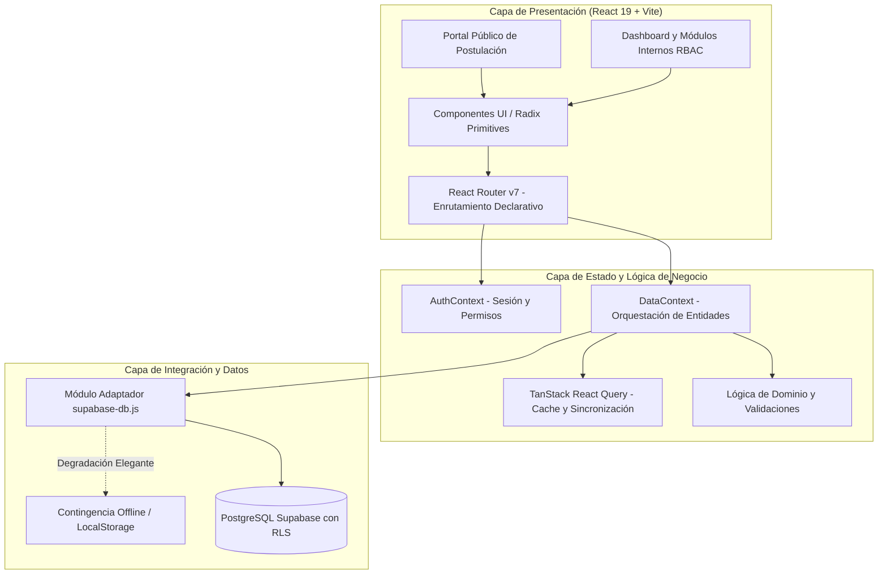
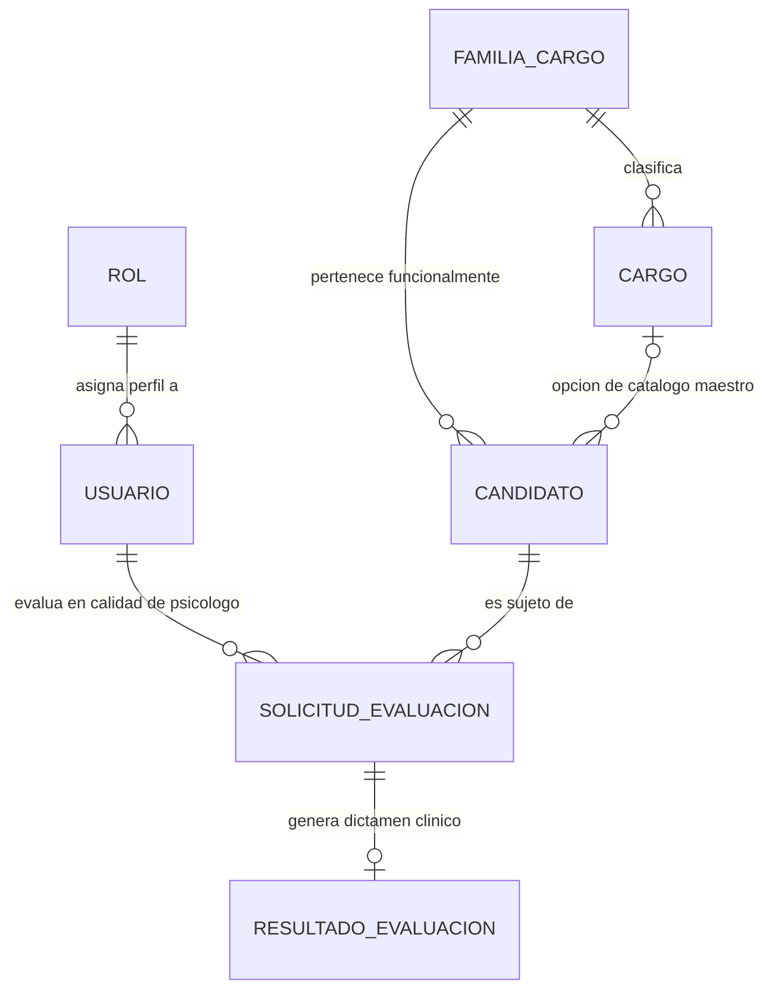

# Candidate Compass — Plataforma de Gestión de Reclutamiento y Evaluación Psicolaboral

Sistema empresarial para la gestión integral del ciclo de selección de personal, postulación de candidatos y evaluación psicolaboral por competencias, diseñado bajo estándares de alta disponibilidad, accesibilidad WAI-ARIA y arquitectura desacoplada con persistencia resiliente en PostgreSQL (Supabase) y almacenamiento en memoria/local.

---

## 1. Resumen Ejecutivo y Alcance

Candidate Compass centraliza y optimiza los flujos operativos de reclutamiento para AquaChile, resolviendo dos dimensiones críticas del proceso:

1. **Portal Público de Postulación:** Punto de entrada para postulantes con validación de identidad (RUT chileno), normalización de contacto internacional y selección dinámica de cargos corporativos mediante componentes híbridos (catálogo maestro o especificación abierta).
2. **Sistema Interno de Gestión (Dashboard):** Plataforma de administración con Control de Acceso Basado en Roles (RBAC), canalización de solicitudes clínicas, asignación de psicólogos evaluadores, guías de entrevista estructuradas por familia de cargo y emisión de dictámenes ejecutivos.

---

## 2. Arquitectura de Software

La aplicación está construida sobre una arquitectura Single Page Application (SPA) modular, tipada dinámicamente y con una estricta separación de responsabilidades:



### Principios de Diseño Implementados

* **Separación de Intereses (SoC):** Desacoplamiento entre componentes visuales, proveedores de contexto y servicios de persistencia externa.
* **Degradación Elegante y Resiliencia:** Si la conectividad hacia la base de datos remota no se encuentra disponible, la capa de datos activa de forma transparente un catálogo y almacenamiento local de contingencia, garantizando la operatividad continua de la interfaz.
* **Integridad Relacional Garantizada:** Control estricto de claves foráneas y restricciones lógicas exclusivas a nivel de motor de base de datos (`check_candidato_cargo`).
* **Accesibilidad WAI-ARIA:** Componentes interactivos basados en primitivas de Radix UI, cumpliendo estándares de navegación por teclado, roles semánticos y contraste visual corporativo.

---

## 3. Pila Tecnológica

| Capa | Tecnología | Justificación y Versión |
| :--- | :--- | :--- |
| **Framework Base** | React 19 | Arquitectura basada en Hooks y renderizado concurrente optimizado. |
| **Empaquetador y Build** | Vite 8 | Servidor de desarrollo instantáneo con HMR nativo y compilación ESM. |
| **Estilos y Diseño** | Tailwind CSS v4 | Motor utility-first con directivas CSS modernas y tiempo de compilación cero en runtime. |
| **Componentes Accesibles** | Radix UI / Shadcn Primitives | Componentes desacoplados sin dependencias de estilo forzadas, con accesibilidad WAI-ARIA nativa. |
| **Enrutamiento** | React Router v7 | Enrutamiento declarativo con soporte para layouts jerárquicos y rutas comodín. |
| **Gestión de Estado Servidor** | TanStack React Query v5 | Cache automatizado, deduplicación de consultas y control de ciclo de vida de datos remotos. |
| **Base de Datos y Backend** | Supabase (PostgreSQL 15+) | Almacenamiento relacional, autenticación por verificación y políticas Row Level Security (RLS). |
| **Testing Suite** | Vitest 5 + React Testing Library + JSDOM | Ejecución de pruebas unitarias y de integración concurrentes con cobertura V8. |
| **Validación y Utilidades** | Zod / Date-fns / Lucide React | Validación de esquemas y utilidades funcionales livianas. |

---

## 4. Modelo de Datos e Integridad Relacional

La base de datos relacional modela el ciclo de vida del reclutamiento desde el catálogo organizativo hasta el dictamen clínico:



### Detalle de Entidades Principales

#### `public.rol`
Establece los perfiles institucionales disponibles (`analista`, `evaluador`, `admin`, `jefatura`).

#### `public.usuario`
Directorio de usuarios institucionales con credenciales corporativas verificables para el ingreso al sistema.

#### `public.familia_cargo` y `public.cargo`
Estructura organizativa corporativa. Divide los puestos en 6 familias:
* Operaciones / Producción
* Tecnología / IT
* Ventas / Comercial
* Recursos Humanos
* Calidad y Medio Ambiente
* Finanzas y Administración

Cada cargo cuenta con estado activo/inactivo y pertenencia obligatoria a una familia.

#### `public.candidato` y la Restricción `check_candidato_cargo`
Almacena la información de los postulantes. Para soportar tanto puestos estandarizados como requerimientos emergentes, la tabla implementa una restricción de validación lógica disyuntiva:

```sql
CONSTRAINT check_candidato_cargo CHECK (
    (cargo_id IS NOT NULL AND cargo_personalizado IS NULL) OR
    (cargo_id IS NULL AND cargo_personalizado IS NOT NULL)
)
```

Esta regla asegura que jamás convivan un identificador de catálogo y un texto libre simultáneamente, ni que ambos permanezcan vacíos, resguardando la integridad analítica de los reportes.

#### `public.solicitud_evaluacion` y `public.resultado_evaluacion`
Entidades transaccionales que orquestan el flujo clínico:
* Estados de Solicitud: `Pendiente`, `En proceso`, `Finalizada`.
* Dictámenes Finales: `Recomendado`, `Con observaciones`, `No recomendado`.

---

## 5. Matriz de Control de Acceso Basado en Roles (RBAC)

El acceso a las distintas vistas y capacidades transaccionales está segmentado según el principio de menor privilegio:

| Capacidad del Sistema | Analista de Reclutamiento (`analista`) | Profesional Evaluador (`evaluador`) | Administrador Académico (`admin`) | Jefatura / Contraparte (`jefatura`) |
| :--- | :---: | :---: | :---: | :---: |
| **Visualización del Panel Principal (KPIs)** | Sí | Sí | Sí | Sí |
| **Consulta de Directorio de Candidatos** | Sí | Sí | Sí | Sí |
| **Registro y Modificación de Candidatos** | Sí | No | Sí | No |
| **Consulta de Solicitudes Clínicas** | Sí | Sí | Sí | Sí |
| **Emisión de Nuevas Solicitudes** | Sí | No | Sí | No |
| **Conducción y Dictamen de Evaluación** | No | Sí | Sí | No |
| **Mantenedor de Catálogos y Usuarios** | No | No | Sí | No |
| **Restablecimiento de Datos a Estado Base** | No | No | Sí | No |

---

## 6. Estructura del Proyecto

Organización física del árbol de directorios de la solución:

```
aquachile/
├── .env                              # Variables de entorno de configuración remota
├── .gitignore                        # Reglas de exclusión de control de versiones
├── components.json                   # Configuración del generador de UI primitives
├── eslint.config.js                  # Reglas de análisis estático de código
├── index.html                        # Punto de entrada HTML5 del bundle SPA
├── jsconfig.json                     # Resolución de alias de módulos (@/*)
├── package.json                      # Manifiesto de dependencias, metadatos y scripts
├── vite.config.js                    # Configuración de compilación, plugins y test runner
├── public/                           # Recursos estáticos servidos directamente
└── src/
    ├── App.jsx                       # Orquestador raíz: Providers y árbol de rutas
    ├── main.jsx                      # Bootstrap y montaje en el DOM
    ├── styles.css                    # Definiciones globales y temas de Tailwind
    ├── assets/                       # Activos gráficos, tipografías e imágenes
    ├── components/                   # Componentes reutilizables y específicos
    │   ├── candidato-dialog.jsx      # Modal de alta y edición de candidatos
    │   ├── cargo-combobox.jsx        # Selector híbrido WAI-ARIA de cargos
    │   ├── estado-badge.jsx          # Badge visual de estados clínicos
    │   ├── phone-input.jsx           # Input telefónico internacional normalizado
    │   ├── solicitud-dialog.jsx      # Modal de generación y asignación de solicitud
    │   └── ui/                       # Primitivas de UI accesibles (Botones, Tablas, etc.)
    ├── context/                      # Estados globales mediante Context API
    │   ├── auth-context.jsx          # Gestión de sesión, credenciales y permisos RBAC
    │   └── data-context.jsx          # Almacenamiento local, sincronización y mutaciones
    ├── data/                         # Catálogos estáticos y estado inicial de respaldo
    ├── hooks/                        # Custom Hooks utilitarios (e.g., responsive design)
    ├── layouts/                      # Plantillas estructurales (AppLayout institucional)
    ├── lib/                          # Capa de utilidades y adaptadores
    │   ├── domain.js                 # Constantes de negocio, roles y catálogo base
    │   ├── supabase.js               # Cliente de inicialización de Supabase
    │   ├── supabase-db.js            # Consultas relacionales y resolución de claves
    │   └── utils.js                  # Funciones auxiliares de estilo (clsx + twMerge)
    ├── pages/                        # Controladores de vista principales
    │   ├── AdministracionPage.jsx    # Mantenedor del sistema y auditoría
    │   ├── CandidatosPage.jsx        # Directorio operativo de postulantes
    │   ├── DetalleSolicitudPage.jsx  # Formulario clínico, preguntas y dictamen
    │   ├── LoginPage.jsx             # Acceso de usuarios corporativos
    │   ├── NotFoundPage.jsx          # Manejador de ruta inexistente (404)
    │   ├── PanelPage.jsx             # Tablero analítico e indicadores ejecutivos
    │   ├── PostulacionPage.jsx       # Formulario público de registro de postulante
    │   └── SolicitudesPage.jsx       # Bandeja de seguimiento de evaluaciones
    ├── services/                     # Abstracción de servicios de integración API
    └── test/                         # Configuración y utilidades de suites de prueba
        └── setup.js                  # Inicialización de mocks globales (matchMedia, JSDOM)
```

---

## 7. Instalación y Puesta en Marcha Local

### Prerrequisitos

* **Node.js:** Versión 20.x o superior (LTS recomendado).
* **NPM:** Versión 10.x o superior.
* Conexión a internet para resolución de paquetes y comunicación con Supabase.

### Procedimiento de Despliegue Local

1. Clonar el repositorio de control de versiones:
   ```bash
   git clone <URL_DEL_REPOSITORIO>
   cd Aquachile
   ```

2. Configurar las variables de entorno:
   Verificar o crear el archivo `.env` en la raíz del proyecto con las credenciales del proyecto de Supabase:
   ```env
   VITE_SUPABASE_URL=https://<TU_PROYECTO>.supabase.co
   VITE_SUPABASE_ANON_KEY=<TU_API_KEY_PUBLICA>
   ```

3. Instalar las dependencias del proyecto:
   ```bash
   npm install
   ```

4. Iniciar el servidor de desarrollo en caliente:
   ```bash
   npm run dev
   ```
   La aplicación quedará expuesta de forma predeterminada en `http://localhost:5173`.

---

## 8. Scripts Disponibles

El archivo `package.json` define los siguientes comandos de ciclo de vida:

| Comando | Acción Ejecutada |
| :--- | :--- |
| `npm run dev` | Inicia el servidor de desarrollo local con Vite en modo reactivo. |
| `npm run build` | Ejecuta la transpilación y genera el bundle optimizado para producción en `dist/`. |
| `npm run build:dev` | Compila el bundle incorporando sourcemaps y etiquetas de depuración. |
| `npm run preview` | Levanta un servidor HTTP local para inspeccionar la versión de producción generada en `dist/`. |
| `npm run test` | Ejecuta el runner de Vitest en modo interactivo/vigía (`watch`). |
| `npm run test:run` | Ejecuta la totalidad de suites de pruebas unitarias en un ciclo cerrado (CI/CD). |
| `npm run test:ui` | Despliega la interfaz visual web de análisis de pruebas de Vitest. |
| `npm run test:coverage` | Genera el informe consolidado de cobertura de código utilizando el motor V8. |
| `npm run lint` | Ejecuta el linter estático ESLint para validación de convenciones de código. |
| `npm run format` | Aplica formateo automático de sintaxis en todo el código base con Prettier. |

---

## 9. Estrategia de Pruebas y Aseguramiento de Calidad

El proyecto adopta una arquitectura de pruebas automatizadas basada en pirámide de testing, garantizando la estabilidad funcional de la capa de dominio, adaptadores de infraestructura y componentes reactivos:

```
Test Files  15 passed (15 suites)
Tests       78 passed (78 tests)
Cobertura   Dominio, RBAC, Supabase, Contextos y Páginas UI
```

### Alcance de las Pruebas Unitarias e Integración

1. **Lógica de Dominio (`src/lib/__tests__/domain.test.js`):**
   * Validación de consistencia de roles institucionales y directivas de permisos RBAC.
   * Integridad en la enumeración de estados y dictámenes válidos.
2. **Servicios de Base de Datos (`src/lib/__tests__/supabase-db.test.js`):**
   * Verificación del mapeo relacional de catálogos desde Supabase.
   * Resolución de la disyuntiva de cargo (`cargo_id` vs `cargo_personalizado`) según `check_candidato_cargo`.
   * Manejo robusto de errores de red y excepciones en consultas.
3. **Manejo de Contextos (`src/context/__tests__/`):**
   * Verificación de persistencia de credenciales en `auth-context`.
   * Integridad en la creación, mutación y borrado de registros en `data-context`.
4. **Flujos de Interfaz de Usuario (`src/pages/__tests__/` y `src/components/__tests__/`):**
   * Validación de formularios reactivos y control de errores en pantalla.
   * Conducción de entrevistas clínicas y cálculo de progreso en `DetalleSolicitudPage`.
   * Comportamiento accesible y filtrado insensibilizado de tildes en `CargoCombobox`.

Para ejecutar la batería completa de pruebas:
```bash
npm run test:run
```

---

## 10. Población Inicial de Base de Datos (Supabase)

Para desplegar el esquema de datos en una instancia limpia de PostgreSQL en Supabase:

1. Ingresar a la consola de administración en [Supabase Dashboard](https://supabase.com).
2. Seleccionar el proyecto correspondiente e ingresar al módulo **SQL Editor** (`>_`).
3. Ejecutar el script SQL de migración y población ubicado en el repositorio (`supabase_poblacion.sql`).
4. El script configurará las tablas relacionales, índices, restricciones `CHECK`, políticas RLS y la inserción del catálogo oficial de cargos y perfiles institucionales.

### Credenciales de Acceso Institucional Preconfiguradas

El sistema valida el inicio de sesión contrastando la dirección de correo institucional contra la tabla `public.usuario`:

| Usuario Institucional | Correo Registrado | Rol Asignado |
| :--- | :--- | :--- |
| Ps. Camila Rojas | `analista@aquachile.cl` | Analista de Reclutamiento |
| Ps. Andrés Miranda | `evaluador@aquachile.cl` | Profesional Evaluador |
| Ps. Valentina Soto | `valentina.soto@aquachile.cl` | Profesional Evaluador |
| Ps. Ignacio Fuentes | `ignacio.fuentes@aquachile.cl` | Profesional Evaluador |
| Administrador Duoc UC | `admin@aquachile.cl` | Administrador Académico |
| Marcelo Crisóstomo | `jefatura@aquachile.cl` | Jefatura o Contraparte |

---

## 11. Consideraciones de Seguridad y Buenas Prácticas

* **Row Level Security (RLS):** Las tablas expuestas en Supabase deben contar con políticas RLS activas, restringiendo las operaciones de inserción y lectura anónima exclusivamente a las rutas públicas (postulaciones), resguardando los dictámenes clínicos tras llaves autenticadas.
* **Separación de Secretos:** La clave `VITE_SUPABASE_ANON_KEY` está restringida por diseño al ámbito público del navegador mediante RLS. Bajo ninguna circunstancia debe alojarse la clave de servicio (`service_role`) en el entorno frontend.
* **Sanitización de Datos de Entrada:** Todos los formularios validan tipos de datos, patrones de expresiones regulares (RUT, correo electrónico y numeración telefónica E.164) previo a su transmisión a la capa de persistencia.
